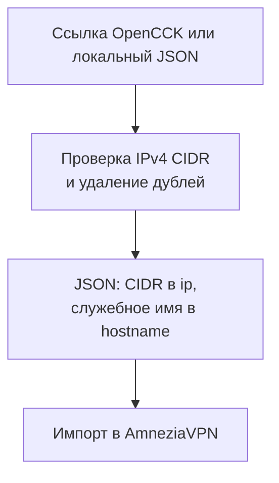

# Amnezia OpenCCK CIDR Converter

[](https://github.com/yaleksandr89/amnezia-opencck-cidr-converter)
[](https://learn.microsoft.com/powershell/)
[](https://www.gnu.org/software/bash/)
[](https://github.com/charmbracelet/gum)
[](https://github.com/yaleksandr89/amnezia-opencck-cidr-converter/actions/workflows/ci.yml)
[](LICENSE)


## Выберите язык

| Русский | English | Español | 中文 | Français | Deutsch |
|---|---|---|---|---|---|
| **Выбран** | [English](docs/langs/en/README.md) | [Español](docs/langs/es/README.md) | [中文](docs/langs/zh/README.md) | [Français](docs/langs/fr/README.md) | [Deutsch](docs/langs/de/README.md) |

Конвертер IPv4 CIDR-списков OpenCCK в JSON для корректного импорта в AmneziaVPN 5.x.

Проект не изменяет клиент и не является его патчем. Он преобразует список перед импортом.

> [!IMPORTANT]
> Это временное решение технической проблемы импорта CIDR, а не официальный формат AmneziaVPN. Проект не связан с командами AmneziaVPN и OpenCCK.

## Решаемая проблема

OpenCCK может вернуть CIDR в поле `hostname`:

```json
{
  "hostname": "142.250.0.0/15",
  "ip": ""
}
```

При проблемном импорте маска подсети может потеряться. Конвертер формирует запись, в которой CIDR хранится в поле `ip`:

```json
{
  "hostname": "route-000001.invalid",
  "ip": "142.250.0.0/15"
}
```

## Что делает конвертер

- принимает ссылку, сформированную на `iplist.opencck.org`;
- принимает локальный JSON в формате OpenCCK;
- проверяет и преобразует корректные IPv4 CIDR-записи;
- удаляет дубли, сохраняя исходный порядок;
- создаёт `amnezia-opencck-cidr.json` (по умолчанию в корне проекта; в TUI — в выбранной папке).

## Как работает конвертер



## Поддерживаемые системы

| Система | Готовый пакет | Архитектура |
|---|---|---|
| Windows 10/11 | `amnezia-opencck-cidr-converter_windows_x64.zip` | x64 |
| Linux | `amnezia-opencck-cidr-converter_linux_x64.tar.gz` | x64 |
| macOS | `amnezia-opencck-cidr-converter_macos_arm64.tar.gz` | Apple Silicon / arm64 |

Windows: Windows PowerShell 5.1 (CLI также поддерживает PowerShell 7). Linux/macOS: Bash, AWK и стандартные системные утилиты; для URL нужен `curl` или `wget`. `gum` 0.17.0 включён в готовые пакеты; для TUI из исходников нужен `gum` в PATH.

## Быстрый старт

### 1. Скачайте готовый пакет

Откройте [GitHub Releases](https://github.com/yaleksandr89/amnezia-opencck-cidr-converter/releases/latest) и скачайте архив для своей системы. Если архив содержит ещё один пакет, распакуйте и его.

После распаковки запускайте:

- Windows: `amnezia-opencck-cidr-converter.exe`;
- Linux/macOS: `./amnezia-opencck-cidr-converter`.

TUI позволяет выбрать источник (ссылку или локальный JSON), папку результата и язык, повторить конвертацию и открыть папку с JSON.

Указывайте для результата отдельный путь, не совпадающий с исходным JSON. При выборе существующего результата успешная конвертация заменяет его. Перед импортом проверьте список маршрутов.

> [!NOTE]
> Windows-сборка не подписана коммерческим сертификатом; SmartScreen может показать предупреждение «Неизвестный издатель».

### 2. Подготовьте ссылку OpenCCK

1. Откройте [iplist.opencck.org](https://iplist.opencck.org/).
2. Выберите нужные сайты и сервисы.
3. Укажите формат **Amnezia**.
4. Укажите тип данных **IP-зоны IPv4 (CIDR)**.
5. Отключите пункт **«Сохранить как файл»**.
6. Скопируйте длинную ссылку из нижнего поля страницы.

### 3. Импортируйте результат

После конвертации импортируйте созданный `amnezia-opencck-cidr.json` в AmneziaVPN.

### Запуск из исходников

Для запуска из исходников клонируйте репозиторий и перейдите в его корень. Команды ниже выполняются из этого каталога.

Windows (PowerShell):

```powershell
git clone https://github.com/yaleksandr89/amnezia-opencck-cidr-converter.git
cd amnezia-opencck-cidr-converter
.\bin\convert-opencck-cidr.cmd
```

Linux/macOS (Bash):

```bash
git clone https://github.com/yaleksandr89/amnezia-opencck-cidr-converter.git
cd amnezia-opencck-cidr-converter
./bin/convert-opencck-cidr.sh
```

## Документация

- [Расширенное использование: CLI, TUI, исходники и тесты](docs/langs/ru/guides/advanced-usage.md)
- [Участие в разработке](.github/CONTRIBUTING.md)
- [Политика безопасности](.github/SECURITY.md)

## Ограничения

- Поддерживается только IPv4 CIDR (`data=cidr4`).
- Для сетевой загрузки принимается только HTTPS-ссылка с домена `iplist.opencck.org`.
- Работа сетевого режима зависит от доступности и формата ответа OpenCCK.
- После исправления импорта в официальном клиенте необходимость в конвертере может исчезнуть.

## Обратная связь

- воспроизводимые ошибки — [GitHub Issues](https://github.com/yaleksandr89/amnezia-opencck-cidr-converter/issues);
- вопросы и идеи — [GitHub Discussions](https://github.com/yaleksandr89/amnezia-opencck-cidr-converter/discussions).
- [Политика безопасности](.github/SECURITY.md).

<p align="center">Если проект оказался полезен, поставьте звезду на GitHub — так его будет проще найти другим разработчикам. 🤘</p>
