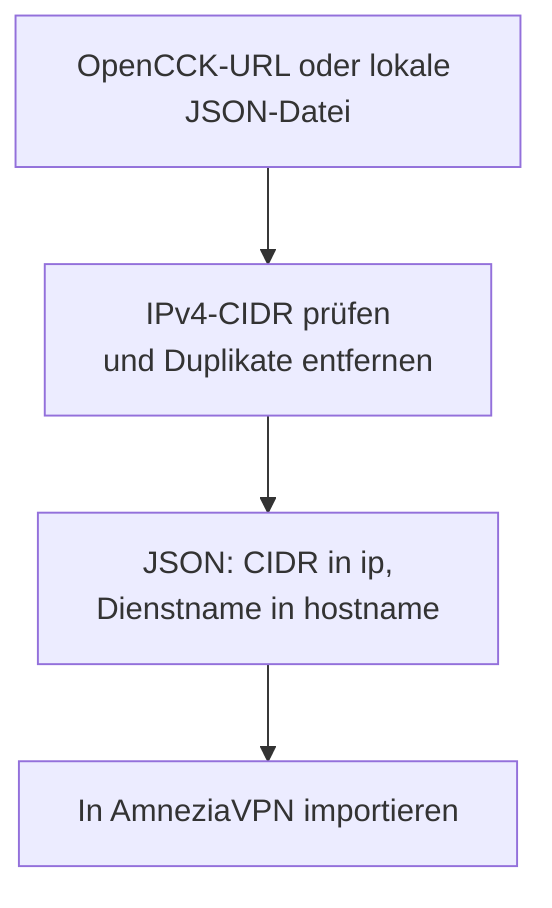

# Amnezia OpenCCK CIDR Converter

[](https://github.com/yaleksandr89/amnezia-opencck-cidr-converter)
[](https://learn.microsoft.com/powershell/)
[](https://www.gnu.org/software/bash/)
[](https://github.com/charmbracelet/gum)
[](https://github.com/yaleksandr89/amnezia-opencck-cidr-converter/actions/workflows/ci.yml)
[](../../../LICENSE)


## Sprache auswählen

| Русский | English | Español | 中文 | Français | Deutsch |
|---|---|---|---|---|---|
| [Русский](../../../README.md) | [English](../en/README.md) | [Español](../es/README.md) | [中文](../zh/README.md) | [Français](../fr/README.md) | **Ausgewählt** |

Konvertiert IPv4-CIDR-Listen von OpenCCK in JSON, das korrekt in AmneziaVPN 5.x importiert werden kann.

Das Projekt verändert oder patcht den Client nicht. Es wandelt die Liste vor dem Import um.

> [!IMPORTANT]
> Dies ist eine vorübergehende Lösung für ein CIDR-Importproblem und kein offizielles AmneziaVPN-Format. Das Projekt steht in keiner Verbindung zu den Teams von AmneziaVPN oder OpenCCK.

## Problem

OpenCCK kann einen CIDR-Wert im Feld `hostname` zurückgeben:

```json
{
  "hostname": "142.250.0.0/15",
  "ip": ""
}
```

Bei einem fehlerhaften Import kann das Subnetzpräfix verloren gehen. Der Konverter erstellt einen Eintrag, in dem der CIDR-Wert in `ip` gespeichert wird:

```json
{
  "hostname": "route-000001.invalid",
  "ip": "142.250.0.0/15"
}
```

## Was der Konverter macht

- akzeptiert eine auf `iplist.opencck.org` erzeugte URL;
- akzeptiert lokale JSON-Dateien im OpenCCK-Format;
- validiert und konvertiert gültige IPv4-CIDR-Einträge;
- entfernt Duplikate und behält die ursprüngliche Reihenfolge bei;
- erstellt `amnezia-opencck-cidr.json` (standardmäßig im Projektstamm; in der TUI im ausgewählten Ordner).

## So funktioniert der Konverter



## Unterstützte Systeme

| System | Fertiges Paket | Architektur |
|---|---|---|
| Windows 10/11 | `amnezia-opencck-cidr-converter_windows_x64.zip` | x64 |
| Linux | `amnezia-opencck-cidr-converter_linux_x64.tar.gz` | x64 |
| macOS | `amnezia-opencck-cidr-converter_macos_arm64.tar.gz` | Apple Silicon / arm64 |

Windows: Windows PowerShell 5.1 (die CLI unterstützt auch PowerShell 7). Linux/macOS: Bash, AWK und Standard-Systemprogramme; der URL-Modus benötigt `curl` oder `wget`. Fertige Pakete enthalten `gum` 0.17.0; die TUI aus dem Quellcode benötigt `gum` in PATH.

## Schnellstart

### 1. Ein fertiges Paket herunterladen

Öffnen Sie [GitHub Releases](https://github.com/yaleksandr89/amnezia-opencck-cidr-converter/releases/latest) und laden Sie das Archiv für Ihr System herunter. Wenn es ein weiteres Paket enthält, entpacken Sie auch dieses.

Starten Sie nach dem Entpacken:

- Windows: `amnezia-opencck-cidr-converter.exe`;
- Linux/macOS: `./amnezia-opencck-cidr-converter`.

Die TUI ermöglicht die Auswahl der Quelle (URL oder lokale JSON-Datei), des Ausgabeordners und der Sprache sowie erneute Konvertierung und das Öffnen des Ausgabeordners.

Wählen Sie einen anderen Ausgabepfad als die Eingabe-JSON-Datei. Eine erfolgreiche Konvertierung ersetzt eine vorhandene Ausgabedatei. Prüfen Sie die Routen vor dem Import.

> [!NOTE]
> Der Windows-Build ist nicht mit einem kommerziellen Zertifikat signiert; SmartScreen kann vor einem unbekannten Herausgeber warnen.

### 2. OpenCCK-URL vorbereiten

1. Öffnen Sie [iplist.opencck.org](https://iplist.opencck.org/).
2. Wählen Sie die benötigten Websites und Dienste.
3. Wählen Sie das Format **Amnezia**.
4. Wählen Sie **IPv4-CIDR-Bereiche**.
5. Deaktivieren Sie **Als Datei speichern**.
6. Kopieren Sie die lange URL aus dem unteren Feld.

### 3. Ergebnis importieren

Importieren Sie nach der Konvertierung die erzeugte Datei `amnezia-opencck-cidr.json` in AmneziaVPN.

### Start aus dem Quellcode

Klonen Sie das Repository und wechseln Sie in dessen Stammverzeichnis. Führen Sie die folgenden Befehle dort aus.

Windows (PowerShell):

```powershell
git clone https://github.com/yaleksandr89/amnezia-opencck-cidr-converter.git
cd amnezia-opencck-cidr-converter
.\bin\convert-opencck-cidr.cmd
```

Linux/macOS (Bash):

```bash
git clone https://github.com/yaleksandr89/amnezia-opencck-cidr-converter.git
cd amnezia-opencck-cidr-converter
./bin/convert-opencck-cidr.sh
```

## Dokumentation

- [Erweiterte Verwendung: CLI, TUI, Quellcode und Tests](guides/advanced-usage.md)
- [Mitwirken](CONTRIBUTING.md)
- [Sicherheitsrichtlinie](SECURITY.md)

## Einschränkungen

- Es wird nur IPv4 CIDR (`data=cidr4`) unterstützt.
- Netzwerk-Downloads akzeptieren nur HTTPS-URLs von `iplist.opencck.org`.
- Der Netzwerkmodus hängt von der Verfügbarkeit und dem Antwortformat von OpenCCK ab.
- Nach einer Korrektur im offiziellen Client wird der Konverter möglicherweise nicht mehr benötigt.

## Rückmeldung

- reproduzierbare Fehler — [GitHub Issues](https://github.com/yaleksandr89/amnezia-opencck-cidr-converter/issues);
- Fragen und Ideen — [GitHub Discussions](https://github.com/yaleksandr89/amnezia-opencck-cidr-converter/discussions).
- [Sicherheitsrichtlinie](SECURITY.md).

<p align="center">Wenn dieses Projekt hilfreich war, geben Sie ihm einen Stern auf GitHub, damit andere Entwickler es leichter finden können. 🤘</p>
