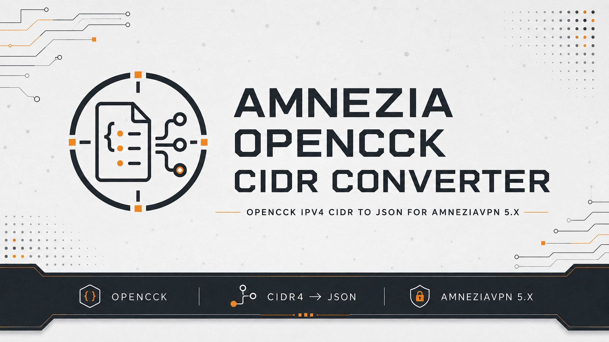
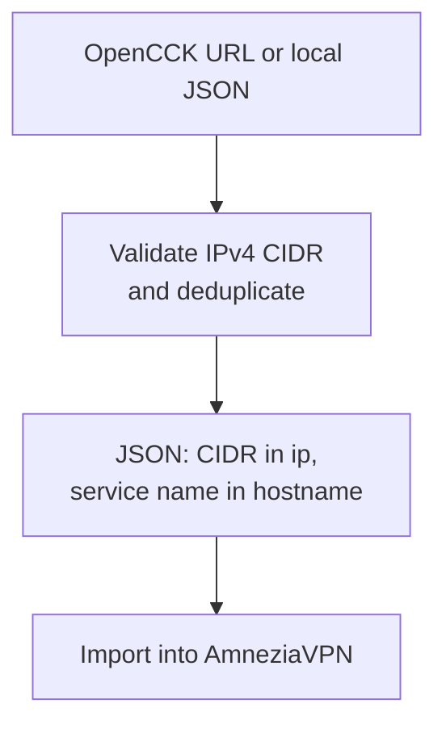

# Amnezia OpenCCK CIDR Converter

[](https://github.com/yaleksandr89/amnezia-opencck-cidr-converter)
[](https://learn.microsoft.com/powershell/)
[](https://www.gnu.org/software/bash/)
[](https://github.com/charmbracelet/gum)
[](https://github.com/yaleksandr89/amnezia-opencck-cidr-converter/actions/workflows/ci.yml)
[](../../../LICENSE)



## Choose a language

| Русский | English | Español | 中文 | Français | Deutsch |
|---|---|---|---|---|---|
| [Русский](../../../README.md) | **Selected** | [Español](../es/README.md) | [中文](../zh/README.md) | [Français](../fr/README.md) | [Deutsch](../de/README.md) |

Converts OpenCCK IPv4 CIDR lists to JSON that can be imported correctly into AmneziaVPN 5.x.

The project does not modify or patch the client. It transforms the list before import.

> [!IMPORTANT]
> This is a temporary workaround for a CIDR import issue, not an official AmneziaVPN format. The project is not affiliated with the AmneziaVPN or OpenCCK teams.

## Problem

OpenCCK may return a CIDR value in the `hostname` field:

```json
{
  "hostname": "142.250.0.0/15",
  "ip": ""
}
```

During a problematic import, the subnet prefix may be lost. The converter creates an entry where the CIDR is stored in `ip`:

```json
{
  "hostname": "route-000001.invalid",
  "ip": "142.250.0.0/15"
}
```

## What the converter does

- accepts a URL generated at `iplist.opencck.org`;
- accepts local JSON in OpenCCK format;
- validates and converts valid IPv4 CIDR entries;
- removes duplicates while preserving the original order;
- creates `amnezia-opencck-cidr.json` (in the project root by default; in the selected folder in the TUI).

## How the converter works



## Supported systems

| System | Ready-to-use package | Architecture |
|---|---|---|
| Windows 10/11 | `amnezia-opencck-cidr-converter_windows_x64.zip` | x64 |
| Linux | `amnezia-opencck-cidr-converter_linux_x64.tar.gz` | x64 |
| macOS | `amnezia-opencck-cidr-converter_macos_arm64.tar.gz` | Apple Silicon / arm64 |

Windows: Windows PowerShell 5.1 (CLI also supports PowerShell 7). Linux/macOS: Bash, AWK and standard system utilities; URL mode needs `curl` or `wget`. `gum` 0.17.0 is bundled in ready-to-use packages; source TUI requires `gum` in PATH.

## Quick start

### 1. Download a ready-to-use package

Open [GitHub Releases](https://github.com/yaleksandr89/amnezia-opencck-cidr-converter/releases/latest) and download the archive for your system. If it contains another package, extract that as well.

After extracting, run:

- Windows: `amnezia-opencck-cidr-converter.exe`;
- Linux/macOS: `./amnezia-opencck-cidr-converter`.

The TUI lets you select the source (URL or local JSON), output folder and language, repeat conversion and open the output folder.

Choose an output path different from the input JSON. Successful conversion replaces an existing output file. Review the route list before importing it.

> [!NOTE]
> The Windows build is not signed with a commercial code-signing certificate; SmartScreen may display an “Unknown publisher” warning.

### 2. Prepare the OpenCCK URL

1. Open [iplist.opencck.org](https://iplist.opencck.org/).
2. Select the required sites and services.
3. Choose the **Amnezia** format.
4. Choose **IPv4 CIDR ranges**.
5. Disable **Save as file**.
6. Copy the long URL from the field at the bottom of the page.

### 3. Import the result

After conversion, import the generated `amnezia-opencck-cidr.json` into AmneziaVPN.

### Running from source

To run from source, clone the repository and enter its root. Run the commands below from that directory.

Windows (PowerShell):

```powershell
git clone https://github.com/yaleksandr89/amnezia-opencck-cidr-converter.git
cd amnezia-opencck-cidr-converter
.\bin\convert-opencck-cidr.cmd
```

Linux/macOS (Bash):

```bash
git clone https://github.com/yaleksandr89/amnezia-opencck-cidr-converter.git
cd amnezia-opencck-cidr-converter
./bin/convert-opencck-cidr.sh
```

## Documentation

- [Advanced usage: CLI, TUI, source and tests](guides/advanced-usage.md)
- [Contributing](CONTRIBUTING.md)
- [Security policy](SECURITY.md)

## Limitations

- Only IPv4 CIDR (`data=cidr4`) is supported.
- Network downloads accept only HTTPS URLs from `iplist.opencck.org`.
- Network mode depends on OpenCCK availability and response format.
- The converter may no longer be needed after the import issue is fixed in the official client.

## Feedback

- reproducible bugs — [GitHub Issues](https://github.com/yaleksandr89/amnezia-opencck-cidr-converter/issues);
- questions and ideas — [GitHub Discussions](https://github.com/yaleksandr89/amnezia-opencck-cidr-converter/discussions).
- [Security policy](SECURITY.md).

<p align="center">If this project was useful, give it a star on GitHub to help other developers find it. 🤘</p>
