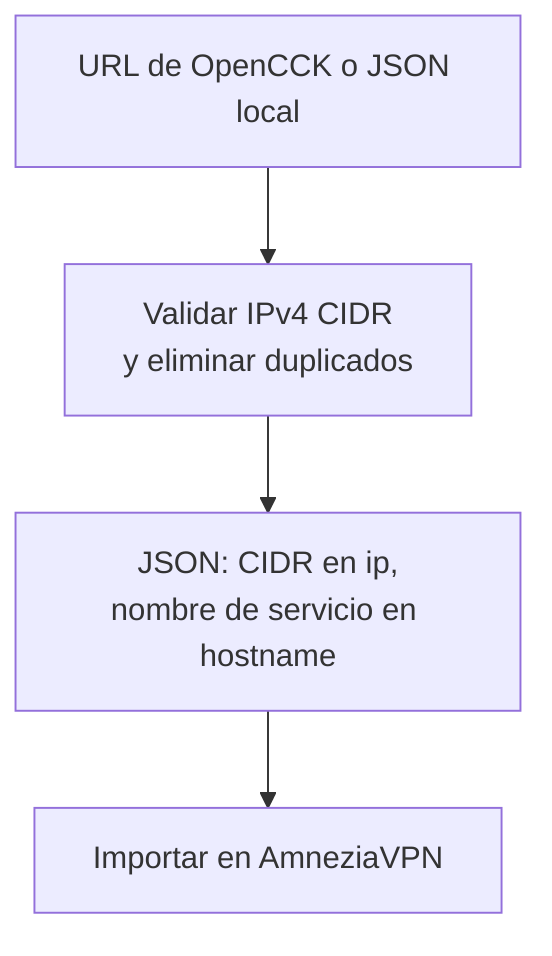

# Amnezia OpenCCK CIDR Converter

[](https://github.com/yaleksandr89/amnezia-opencck-cidr-converter)
[](https://learn.microsoft.com/powershell/)
[](https://www.gnu.org/software/bash/)
[](https://github.com/charmbracelet/gum)
[](https://github.com/yaleksandr89/amnezia-opencck-cidr-converter/actions/workflows/ci.yml)
[](../../../LICENSE)


## Elija un idioma

| Русский | English | Español | 中文 | Français | Deutsch |
|---|---|---|---|---|---|
| [Русский](../../../README.md) | [English](../en/README.md) | **Seleccionado** | [中文](../zh/README.md) | [Français](../fr/README.md) | [Deutsch](../de/README.md) |

Convierte listas IPv4 CIDR de OpenCCK a JSON para importarlas correctamente en AmneziaVPN 5.x.

El proyecto no modifica ni parchea el cliente. Transforma la lista antes de importarla.

> [!IMPORTANT]
> Esta es una solución temporal para un problema de importación CIDR, no un formato oficial de AmneziaVPN. El proyecto no está afiliado con los equipos de AmneziaVPN ni OpenCCK.

## Problema

OpenCCK puede devolver un valor CIDR en el campo `hostname`:

```json
{
  "hostname": "142.250.0.0/15",
  "ip": ""
}
```

Durante una importación problemática puede perderse el prefijo de subred. El convertidor crea una entrada donde el CIDR se guarda en `ip`:

```json
{
  "hostname": "route-000001.invalid",
  "ip": "142.250.0.0/15"
}
```

## Qué hace el convertidor

- acepta una URL generada en `iplist.opencck.org`;
- acepta JSON local en formato OpenCCK;
- valida y convierte entradas IPv4 CIDR correctas;
- elimina duplicados conservando el orden original;
- crea `amnezia-opencck-cidr.json` (por defecto en la raíz del proyecto; en la TUI, en la carpeta elegida).

## Cómo funciona el convertidor



## Sistemas compatibles

| Sistema | Paquete listo para usar | Arquitectura |
|---|---|---|
| Windows 10/11 | `amnezia-opencck-cidr-converter_windows_x64.zip` | x64 |
| Linux | `amnezia-opencck-cidr-converter_linux_x64.tar.gz` | x64 |
| macOS | `amnezia-opencck-cidr-converter_macos_arm64.tar.gz` | Apple Silicon / arm64 |

Windows: Windows PowerShell 5.1 (la CLI también admite PowerShell 7). Linux/macOS: Bash, AWK y utilidades estándar; para URL se necesita `curl` o `wget`. Los paquetes incluyen `gum` 0.17.0; la TUI desde el código fuente requiere `gum` en PATH.

## Inicio rápido

### 1. Descargue un paquete listo para usar

Abra [GitHub Releases](https://github.com/yaleksandr89/amnezia-opencck-cidr-converter/releases/latest) y descargue el archivo de su sistema. Si contiene otro paquete, extráigalo también.

Tras extraerlo, ejecute:

- Windows: `amnezia-opencck-cidr-converter.exe`;
- Linux/macOS: `./amnezia-opencck-cidr-converter`.

La TUI permite elegir la fuente (URL o JSON local), la carpeta de salida y el idioma, repetir la conversión y abrir la carpeta de salida.

Elija una ruta de salida distinta del JSON de entrada. Una conversión correcta sustituye el archivo de salida existente. Revise las rutas antes de importarlas.

> [!NOTE]
> La compilación de Windows no está firmada con un certificado comercial; SmartScreen puede mostrar una advertencia de editor desconocido.

### 2. Prepare la URL de OpenCCK

1. Abra [iplist.opencck.org](https://iplist.opencck.org/).
2. Seleccione los sitios y servicios necesarios.
3. Elija el formato **Amnezia**.
4. Elija **rangos IPv4 CIDR**.
5. Desactive **Guardar como archivo**.
6. Copie la URL larga del campo inferior.

### 3. Importe el resultado

Tras la conversión, importe el archivo `amnezia-opencck-cidr.json` generado en AmneziaVPN.

### Ejecución desde el código fuente

Clone el repositorio y entre en su raíz. Ejecute los comandos siguientes desde ese directorio.

Windows (PowerShell):

```powershell
git clone https://github.com/yaleksandr89/amnezia-opencck-cidr-converter.git
cd amnezia-opencck-cidr-converter
.\bin\convert-opencck-cidr.cmd
```

Linux/macOS (Bash):

```bash
git clone https://github.com/yaleksandr89/amnezia-opencck-cidr-converter.git
cd amnezia-opencck-cidr-converter
./bin/convert-opencck-cidr.sh
```

## Documentación

- [Uso avanzado: CLI, TUI, código fuente y pruebas](guides/advanced-usage.md)
- [Contribuir](CONTRIBUTING.md)
- [Política de seguridad](SECURITY.md)

## Limitaciones

- Solo se admite IPv4 CIDR (`data=cidr4`).
- Las descargas de red solo aceptan URL HTTPS de `iplist.opencck.org`.
- El modo de red depende de la disponibilidad y del formato de respuesta de OpenCCK.
- El convertidor puede dejar de ser necesario cuando se corrija el problema en el cliente oficial.

## Comentarios

- errores reproducibles — [GitHub Issues](https://github.com/yaleksandr89/amnezia-opencck-cidr-converter/issues);
- preguntas e ideas — [GitHub Discussions](https://github.com/yaleksandr89/amnezia-opencck-cidr-converter/discussions).
- [Política de seguridad](SECURITY.md).

<p align="center">Si el proyecto le resultó útil, dele una estrella en GitHub para que otros desarrolladores puedan encontrarlo. 🤘</p>
