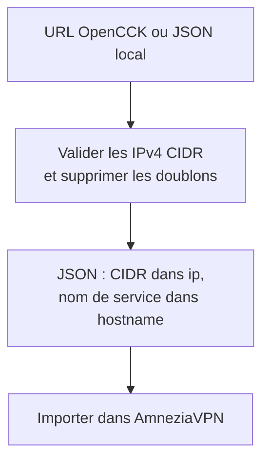

# Amnezia OpenCCK CIDR Converter

[](https://github.com/yaleksandr89/amnezia-opencck-cidr-converter)
[](https://learn.microsoft.com/powershell/)
[](https://www.gnu.org/software/bash/)
[](https://github.com/charmbracelet/gum)
[](https://github.com/yaleksandr89/amnezia-opencck-cidr-converter/actions/workflows/ci.yml)
[](../../../LICENSE)


## Choisissez une langue

| Русский | English | Español | 中文 | Français | Deutsch |
|---|---|---|---|---|---|
| [Русский](../../../README.md) | [English](../en/README.md) | [Español](../es/README.md) | [中文](../zh/README.md) | **Sélectionné** | [Deutsch](../de/README.md) |

Convertit les listes IPv4 CIDR d’OpenCCK en JSON afin de les importer correctement dans AmneziaVPN 5.x.

Le projet ne modifie pas le client et ne constitue pas un correctif. Il transforme la liste avant l’importation.

> [!IMPORTANT]
> Il s’agit d’une solution temporaire à un problème d’importation CIDR, et non d’un format officiel d’AmneziaVPN. Le projet n’est affilié ni à l’équipe AmneziaVPN ni à l’équipe OpenCCK.

## Problème

OpenCCK peut renvoyer une valeur CIDR dans le champ `hostname` :

```json
{
  "hostname": "142.250.0.0/15",
  "ip": ""
}
```

Lors d’une importation problématique, le préfixe de sous-réseau peut être perdu. Le convertisseur crée une entrée où le CIDR est stocké dans `ip` :

```json
{
  "hostname": "route-000001.invalid",
  "ip": "142.250.0.0/15"
}
```

## Fonctionnement du convertisseur

- accepte une URL générée sur `iplist.opencck.org` ;
- accepte un JSON local au format OpenCCK ;
- valide et convertit les entrées IPv4 CIDR correctes ;
- supprime les doublons tout en conservant l’ordre d’origine ;
- crée `amnezia-opencck-cidr.json` (par défaut à la racine du projet ; dans le TUI, dans le dossier choisi) .

## Comment fonctionne le convertisseur



## Systèmes pris en charge

| Système | Paquet prêt à utiliser | Architecture |
|---|---|---|
| Windows 10/11 | `amnezia-opencck-cidr-converter_windows_x64.zip` | x64 |
| Linux | `amnezia-opencck-cidr-converter_linux_x64.tar.gz` | x64 |
| macOS | `amnezia-opencck-cidr-converter_macos_arm64.tar.gz` | Apple Silicon / arm64 |

Windows : Windows PowerShell 5.1 (la CLI prend aussi en charge PowerShell 7). Linux/macOS : Bash, AWK et outils système standard ; le mode URL nécessite `curl` ou `wget`. Les paquets incluent `gum` 0.17.0 ; le TUI depuis les sources requiert `gum` dans PATH.

## Démarrage rapide

### 1. Télécharger un paquet prêt à utiliser

Ouvrez [GitHub Releases](https://github.com/yaleksandr89/amnezia-opencck-cidr-converter/releases/latest) et téléchargez l’archive adaptée à votre système. Si elle contient un autre paquet, extrayez-le également.

Après extraction, lancez :

- Windows: `amnezia-opencck-cidr-converter.exe`;
- Linux/macOS: `./amnezia-opencck-cidr-converter`.

Le TUI permet de choisir la source (URL ou JSON local), le dossier de sortie et la langue, de répéter la conversion et d’ouvrir le dossier de sortie.

Choisissez un chemin de sortie différent du JSON d’entrée. Une conversion réussie remplace le fichier de sortie existant. Vérifiez les routes avant de les importer.

> [!NOTE]
> La version Windows n’est pas signée avec un certificat commercial ; SmartScreen peut signaler un éditeur inconnu.

### 2. Préparez l’URL OpenCCK

1. Ouvrez [iplist.opencck.org](https://iplist.opencck.org/).
2. Sélectionnez les sites et services nécessaires.
3. Choisissez le format **Amnezia**.
4. Choisissez les **plages IPv4 CIDR**.
5. Désactivez **Enregistrer dans un fichier**.
6. Copiez l’URL longue affichée en bas de la page.

### 3. Importer le résultat

Après conversion, importez le fichier `amnezia-opencck-cidr.json` généré dans AmneziaVPN.

### Exécution depuis les sources

Clonez le dépôt et placez-vous à sa racine. Exécutez les commandes ci-dessous depuis ce dossier.

Windows (PowerShell):

```powershell
git clone https://github.com/yaleksandr89/amnezia-opencck-cidr-converter.git
cd amnezia-opencck-cidr-converter
.\bin\convert-opencck-cidr.cmd
```

Linux/macOS (Bash):

```bash
git clone https://github.com/yaleksandr89/amnezia-opencck-cidr-converter.git
cd amnezia-opencck-cidr-converter
./bin/convert-opencck-cidr.sh
```

## Documentation

- [Utilisation avancée : CLI, TUI, sources et tests](guides/advanced-usage.md)
- [Contribuer](CONTRIBUTING.md)
- [Politique de sécurité](SECURITY.md)

## Limites

- Seul IPv4 CIDR (`data=cidr4`) est pris en charge.
- Les téléchargements réseau n’acceptent que les URL HTTPS de `iplist.opencck.org`.
- Le mode réseau dépend de la disponibilité et du format de réponse d’OpenCCK.
- Le convertisseur peut devenir inutile lorsque le problème sera corrigé dans le client officiel.

## Retours

- erreurs reproductibles — [GitHub Issues](https://github.com/yaleksandr89/amnezia-opencck-cidr-converter/issues) ;
- questions et idées — [GitHub Discussions](https://github.com/yaleksandr89/amnezia-opencck-cidr-converter/discussions).
- [Politique de sécurité](SECURITY.md).

<p align="center">Si ce projet vous a été utile, attribuez-lui une étoile sur GitHub pour aider les autres développeurs à le trouver. 🤘</p>
