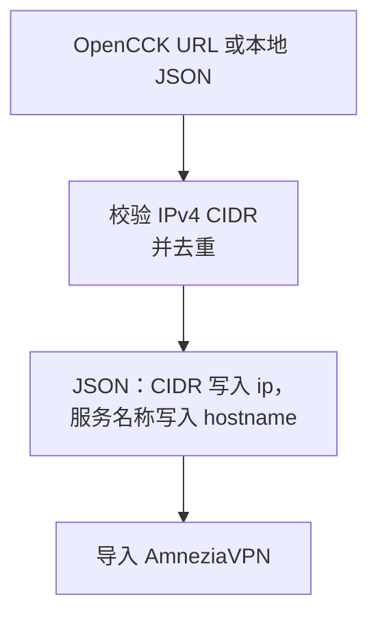

# Amnezia OpenCCK CIDR Converter

[](https://github.com/yaleksandr89/amnezia-opencck-cidr-converter)
[](https://learn.microsoft.com/powershell/)
[](https://www.gnu.org/software/bash/)
[](https://github.com/charmbracelet/gum)
[](https://github.com/yaleksandr89/amnezia-opencck-cidr-converter/actions/workflows/ci.yml)
[](../../../LICENSE)


## 选择语言

| Русский | English | Español | 中文 | Français | Deutsch |
|---|---|---|---|---|---|
| [Русский](../../../README.md) | [English](../en/README.md) | [Español](../es/README.md) | **已选择** | [Français](../fr/README.md) | [Deutsch](../de/README.md) |

将 OpenCCK 的 IPv4 CIDR 列表转换为可正确导入 AmneziaVPN 5.x 的 JSON。

本项目不会修改或修补客户端，只会在导入前转换列表格式。

> [!IMPORTANT]
> 这是针对 CIDR 导入问题的临时解决方案，并非 AmneziaVPN 官方格式。本项目与 AmneziaVPN 或 OpenCCK 团队均无关联。

## 问题说明

OpenCCK 可能会在 `hostname` 字段中返回 CIDR：

```json
{
  "hostname": "142.250.0.0/15",
  "ip": ""
}
```

出现导入问题时，子网前缀可能会丢失。转换器会生成一条将 CIDR 保存在 `ip` 字段中的记录：

```json
{
  "hostname": "route-000001.invalid",
  "ip": "142.250.0.0/15"
}
```

## 转换器的功能

- 接收由 `iplist.opencck.org` 生成的 URL；
- 接收 OpenCCK 格式的本地 JSON；
- 校验并转换有效的 IPv4 CIDR 记录；
- 去除重复项并保留原始顺序；
- 生成 `amnezia-opencck-cidr.json`（默认位于项目根目录，TUI 则使用所选目录）。

## 转换器工作流程



## 支持的系统

| 系统 | 可直接使用的软件包 | 架构 |
|---|---|---|
| Windows 10/11 | `amnezia-opencck-cidr-converter_windows_x64.zip` | x64 |
| Linux | `amnezia-opencck-cidr-converter_linux_x64.tar.gz` | x64 |
| macOS | `amnezia-opencck-cidr-converter_macos_arm64.tar.gz` | Apple Silicon / arm64 |

Windows：Windows PowerShell 5.1（CLI 也支持 PowerShell 7）。Linux/macOS：Bash、AWK 和标准系统工具；URL 模式需要 `curl` 或 `wget`。软件包包含 `gum` 0.17.0；从源码运行 TUI 时需在 PATH 中提供 `gum`。

## 快速开始

### 1. 下载可直接使用的软件包

打开 [GitHub Releases](https://github.com/yaleksandr89/amnezia-opencck-cidr-converter/releases/latest) 并下载适用于系统的压缩包。如果其中还有软件包，请继续解压。

解压后运行：

- Windows: `amnezia-opencck-cidr-converter.exe`;
- Linux/macOS: `./amnezia-opencck-cidr-converter`.

TUI 支持选择来源（URL 或本地 JSON）、输出目录和语言，重复转换并打开输出目录。

输出路径应与输入 JSON 不同。转换成功时会替换现有输出文件。导入前请检查路由列表。

> [!NOTE]
> Windows 构建未使用商业代码签名证书签名，SmartScreen 可能提示发布者未知。

### 2. 准备 OpenCCK URL

1. 打开 [iplist.opencck.org](https://iplist.opencck.org/)。
2. 选择所需的网站和服务。
3. 选择 **Amnezia** 格式。
4. 选择 **IPv4 CIDR 网段**。
5. 关闭 **保存为文件**。
6. 复制页面底部字段中的长 URL。

### 3. 导入结果

转换完成后，将生成的 `amnezia-opencck-cidr.json` 导入 AmneziaVPN。

### 从源码运行

克隆仓库并进入项目根目录。从该目录运行以下命令。

Windows (PowerShell):

```powershell
git clone https://github.com/yaleksandr89/amnezia-opencck-cidr-converter.git
cd amnezia-opencck-cidr-converter
.\bin\convert-opencck-cidr.cmd
```

Linux/macOS (Bash):

```bash
git clone https://github.com/yaleksandr89/amnezia-opencck-cidr-converter.git
cd amnezia-opencck-cidr-converter
./bin/convert-opencck-cidr.sh
```

## 文档

- [高级使用：CLI、TUI、源码和测试](guides/advanced-usage.md)
- [参与开发](CONTRIBUTING.md)
- [安全政策](SECURITY.md)

## 限制

- 仅支持 IPv4 CIDR（`data=cidr4`）。
- 网络下载仅接受 `iplist.opencck.org` 的 HTTPS URL。
- 网络模式依赖 OpenCCK 的可用性和响应格式。
- 官方客户端修复导入问题后，可能不再需要本转换器。

## 反馈

- 可复现的错误 — [GitHub Issues](https://github.com/yaleksandr89/amnezia-opencck-cidr-converter/issues)；
- 问题和建议 — [GitHub Discussions](https://github.com/yaleksandr89/amnezia-opencck-cidr-converter/discussions)。
- [安全政策](SECURITY.md).

<p align="center">如果这个项目对您有帮助，请在 GitHub 上点亮星标，让其他开发者更容易找到它。 🤘</p>
